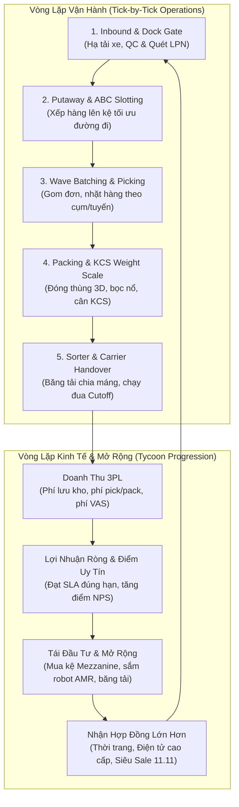

# 📦 MASTER GAME DESIGN DOCUMENT (GDD)
# NEXT-GEN 3D E-COMMERCE FULFILLMENT CENTER & LOGISTICS TYCOON SIMULATOR

> **Tài liệu Thiết Kế Game & Kiến Trúc Mô Phỏng Vận Hành Trung Tâm Hoàn Tất Đơn Hàng (Fulfillment Hub)**  
> *Được tổng hợp và ghép nối từ 8 phiên nghiên cứu chuyên sâu (Parallel Research Streams) qua Genspark AI Gateway.*

---

## 1. TỔNG QUAN DỰ ÁN & Ý TƯỞNG CỐT LÕI (GAME CONCEPT)

### 1.1. Định vị Thể loại (Genre & Positioning)
* **Thể loại**: 3D Isometric Management Tycoon / Industrial Logistics Simulation / Digital Twin Strategy.
* **Cảm hứng thiết kế**: Sự chuẩn xác và dây chuyền tự động hóa của *Factorio*, tính chiến thuật vi mô và quản lý nhân sự của *Two Point Hospital / RimWorld*, cùng góc nhìn điều hành hiện đại của *SimCity 4* và các hệ thống *Mission Control SCADA* thực tế.
* **Core Fantasy (Trải nghiệm thỏa mãn của người chơi)**: 
  Từ một nhà kho trống 500m² với vài chiếc xe đẩy tay và nhân viên thời vụ, người chơi từng bước giải quyết các bài toán hóc búa về luồng di chuyển, tối ưu vị trí lưu kho, chống nghẽn lối đi, đối đầu với các đợt bùng nổ đơn hàng Siêu Sale 11.11, và xây dựng nên một **Siêu Trung Tâm Hoàn Tất Đơn Hàng (Mega Fulfillment Hub) 35.000m²** hoạt động tự động hóa 24/7 với hàng trăm robot AMR, cẩu ASRS và vòng băng tải phân loại tốc độ cao.

---

### 1.2. Vòng Lặp Trò Chơi Cốt Lõi (Core Gameplay Loops)



1. **Vòng lặp vi mô (Micro Operational Loop - Thời gian thực)**:
   - Xe container chở hàng tới cổng dock -> Công nhân dỡ hàng, kiểm tra ngoại quan KCS, quét mã LPN -> Xe nâng cất hàng vào vị trí kệ dựa trên tần suất bán chạy (ABC Analysis) -> Hệ thống tự động gom đơn hàng thương mại điện tử thành các Wave -> Người nhặt hàng (Picker) hoặc robot bưng kệ (AMR) di chuyển lấy hàng -> Đưa tới bàn đóng gói, chọn thùng vừa vặn, bọc bóng khí, cân KCS kiểm tra trọng lượng -> Đẩy lên băng chuyền phân loại máng theo từng bưu cục vận chuyển -> Xếp lên xe tải bưu tá trước giờ xuất bến (Cutoff Time).

2. **Vòng lặp vĩ mô (Macro Economic Loop - Theo ngày/ca làm việc)**:
   - Thu tiền phí lưu kho theo m³ (CBM) mỗi ngày + phí xử lý từng đơn hàng + phí gia công VAS -> Trừ chi phí thuê mặt bằng, điện năng, lương ca kíp/OT, khấu hao máy móc, và phí phạt vi phạm cam kết SLA -> Thu về Lợi nhuận ròng -> Nâng cấp mặt bằng, mở thêm tầng lửng Mezzanine, mua robot tự hành, tuyển dụng chuyên gia giỏi -> Đấu thầu hợp đồng với các sàn TMĐT và nhãn hàng lớn hơn.

---

## 2. CHI TIẾT 8 PHÂN HỆ NGHIỆP VỤ & CƠ CHẾ GAMEPLAY (THE 8 MODULES)

### 📌 Phân hệ 1: Inbound Logistics, QC Inspection & Putaway Slotting
*(Tổng hợp từ Research Stream 1)*

```
[Inbound Container] ──► [Dock Door Appointment] ──► [Unloading Staging] ──► [LPN Barcode & QC Triage] ──► [ABC Directed Putaway]
```

* **Cơ chế Vận hành Thực tế**:
  - **Dock Scheduling & ASN**: Xe chở hàng đến theo khung giờ hẹn (Appointment Slot). Xe đến trễ bị mất quyền ưu tiên, xe nằm chờ quá 120 phút bắt đầu phát sinh phí phạt neo xe (Demurrage Fee).
  - **Phân loại dỡ hàng**: Hàng đóng sẵn Pallet (dỡ nhanh bằng xe nâng) vs Hàng xếp rời trong thùng xe (Floor-loaded loose cartons, tốn nhiều nhân công dỡ từng thùng).
  - **Kiểm soát chất lượng (Inbound QC)**: Dùng máy quét OCR đọc hạn sử dụng (Expiry Date) đối với hàng mỹ phẩm/FMCG; quét mã LPN (License Plate Number) gán cho từng kiện; phân luồng hàng móp méo/rách bao bì vào lồng cách ly (Quarantine Cage) để xử lý Trả về nhà cung cấp (RTV).
  - **Thuật toán Slotting ABC**:
    - **Nhóm A (Fast Movers - 20% SKU tạo 80% lượt pick)**: Xếp ở tầng kệ thấp gần trạm đóng gói để giảm thiểu tối đa quãng đường di chuyển.
    - **Nhóm B (Medium Movers - 30% SKU tạo 15% lượt pick)**: Xếp ở các lối đi giữa.
    - **Nhóm C (Slow Movers - 50% SKU chỉ chiếm 5% lượt pick)**: Đưa lên các tầng kệ trên cao hoặc góc xa kho.
* **Cơ chế Game Hóa & Thử Thách**:
  - **Cân não "Hối hả cất tạm" vs "Slotting bài bản"**: Nếu sân đệm hạ tải bị đầy (Staging Overflow), người chơi có thể chọn lệnh "Fast Dump" (nhét bừa vào bất kỳ ô trống nào gần nhất). Kết quả: Giải phóng dock ngay lập tức, nhưng 2 tiếng sau khi nhặt đơn, người đi nhặt hàng sẽ mất gấp 3 lần thời gian di chuyển tìm kiếm, gây sập SLA đơn hàng!
  - **Nâng cấp công nghệ Inbound**:
    - *Cấp 1*: Xe kéo tay thủy lực thủ công (Hand Pallet Jack) - Dỡ 1 container mất 3 giờ.
    - *Cấp 2*: Xe nâng điện Counterbalance Forklift - Dỡ 1 container mất 45 phút.
    - *Cấp 3*: Băng chuyền ống lồng thụt thò (Telescopic Boom Conveyor) đưa thẳng vào lòng xe tải - Tự động dẫn thùng carton vào line tiếp nhận.

---

### 📌 Phân hệ 2: Wave Management, Batch Picking & Routing Optimization
*(Tổng hợp từ Research Stream 2)*

```
[Customer Orders Pool] ──► [Wave Batching Heuristic] ──► [TSP Optimized Pick Path] ──► [Zone / Cluster Pick] ──► [Sorting Wall / Pack Infeed]
```

* **Cơ chế Vận hành Thực tế**:
  - **Chiến lược gom đơn (Wave Release)**: 
    - *Single-order picking*: Nhặt từng đơn (chỉ dùng cho đơn cồng kềnh B2B).
    - *Batch picking*: Gom 50 đơn hàng có chung vị trí lối đi kệ lại nhặt một lượt vào xe đẩy nhiều ngăn (Cluster cart).
    - *Zone picking (Pick-and-Pass)*: Mỗi nhân viên phụ trách một khu kệ cố định, chuyền thùng hàng qua từng khu vực.
  - **Giải thuật đường đi trong lối đi kho (In-Aisle TSP Heuristics)**:
    - *S-Shape Routing*: Đi luồn lách hình chữ S xuyên qua các dãy kệ, không quay đầu.
    - *Largest Gap*: Chỉ đi vào lối đi đến điểm cần lấy sâu nhất rồi vòng ra nếu khoảng trống còn lại quá lớn.
* **Cơ chế Game Hóa & Thử Thách**:
  - **Ùn tắc lối đi (Aisle Congestion & Deadlock)**:
    Nếu người chơi thiết kế lối đi quá hẹp ($1.8\text{m}$) để tăng diện tích chứa hàng, khi 2 xe nâng Reach Truck đối đầu nhau trong cùng một lối đi, hệ thống rơi vào trạng thái nghẽn mạng giao thông (Gridlock). Người chơi phải bấm còi điều phối hoặc quy định lối đi một chiều (One-Way Aisle Rule).
  - **Cây công nghệ Nhặt hàng**:
    - *Cấp 1*: Phiếu in giấy (Paper Pick Sheet) - Tốc độ $40$ UPH, tỷ lệ nhặt sai $3.5\%$.
    - *Cấp 2*: Máy quét mã vạch không dây cầm tay (PDA / RF Gun) - Tốc độ $90$ UPH, tỷ lệ sai $< 0.5\%$.
    - *Cấp 3*: Hệ thống hướng dẫn bằng giọng nói (Voice Picking) / Đèn Led chỉ điểm (Pick-to-Light Carts) - Tốc độ $160$ UPH.
    - *Cấp 4*: Robot tự hành chở kệ hàng tới người (AMR Goods-to-Person Kiva System) - Tốc độ $350+$ UPH, người nhặt đứng cố định một chỗ, robot xoay kệ mang mặt hàng tới tận tay!

---

### 📌 Phân hệ 3: Packing Station, 3D Cartonization & KCS Weight Scale
*(Tổng hợp từ Research Stream 3)*

```
[Picked Tote Arrival] ──► [3D Box Sizing Optimization] ──► [VAS & Bubble Wrap] ──► [Inline Checkweigher Scale] ──► [Auto SLAP Labeler]
```

* **Cơ chế Vận hành Thực tế**:
  - **Thuật toán chọn thùng 3D (Cartonization)**: Tính toán kích thước 3 chiều của các món hàng để chọn loại thùng nhỏ nhất vừa vặn, giảm thiểu chi phí cước vận chuyển quy đổi theo thể tích (Dimensional Weight: $\frac{L \times W \times H}{5000}$).
  - **Gia công giá trị gia tăng (VAS)**: Bọc màng xốp khí (Bubble Wrap) cho đồ thủy tinh, dán nhãn Hàng Dễ Vỡ (Fragile), chèn thiệp cảm ơn, đóng gói combo quà tặng.
  - **Cân KCS tự động đối chiếu dữ liệu chuẩn (Inline Checkweigher)**:
    - Khi kiện hàng trượt qua cân băng chuyền, hệ thống so sánh trọng lượng thực tế với trọng lượng lý thuyết trong cơ sở dữ liệu:
      
      $$\Delta W = |W_{\text{actual}} - (W_{\text{carton}} + \sum W_{\text{SKU}} + W_{\text{dunnage}})|$$

    - Nếu $\Delta W > \pm 15\text{g}$, xi-lanh khí nén lập tức đẩy kiện hàng sang làn xả lỗi (Reject Spur) để kiểm tra lại: Chống nhặt thiếu quà tặng hoặc nhặt nhầm mã sản phẩm đắt tiền!
* **Cơ chế Game Hóa & Thử Thách**:
  - **Quản lý kho vật tư đóng gói (Packaging Consumables)**:
    Người chơi phải lên đơn mua trước thùng carton các cỡ số 1, 2, 3, 4, 5, cuộn màng bóng khí, băng dính. Nếu mải mê đóng hàng mà quên mua thùng số 3, toàn bộ trạm đóng gói sẽ đình trệ (Out-of-Packaging Alert)!
  - **Nâng cấp trạm đóng**:
    - Bàn đóng gỗ thủ công -> Bàn đóng gắn con lăn trợ lực -> Máy dán băng dính tự động hai đầu -> Máy tự động tạo thùng 3D theo kích thước món hàng (Box-on-Demand Machine) cắt giảm $40\%$ lượng giấy carton tiêu thụ.

---

### 📌 Phân hệ 4: Sortation Loops, Chute Allocation & Carrier Cutoff SLA
*(Tổng hợp từ Research Stream 4)*

```
[Sealed Parcels on Conveyor] ──► [6-Sided Barcode Scan Tunnel] ──► [Cross-Belt Sorter Loop] ──► [Carrier Chute Buffers] ──► [Truck Fluid Loading]
```

* **Cơ chế Vận hành Thực tế**:
  - **Vòng chia hàng tự động (Cross-Belt Loop Sorter)**: Kiện hàng chạy trên vòng băng tải kín với tốc độ $2.5\text{ m/s}$, đi qua hầm quét mã vạch đa hướng (6-sided Scan Tunnel) để nhận diện mã bưu cục đích.
  - **Phân bổ máng xả (Dynamic Chute Allocation)**: Máng 1-5 dành cho Đơn hàng Hỏa tốc 2H, Máng 6-15 dành cho Bưu điện Chuyển phát Tiêu chuẩn, Máng 16-20 dành cho Giao dịch Liên tỉnh.
  - **Xử lý tắc máng (Chute Jamming & Recirculation)**: Khi một máng xả đầy kiện hàng mà nhân viên bốc xếp chưa kịp nhấc ra bao tải, kiện hàng tiếp theo sẽ không rơi xuống được mà phải chạy tuần hoàn một vòng nữa trên băng tải (Recirculation). Nếu tỷ lệ hồi chuyển vượt quá $15\%$, băng tải upstream sẽ tự động ngắt để chống quá tải sập ray.
  - **Hạn chót xe xuất bến (Carrier Cutoff Deadlines)**: Các hãng vận chuyển có giờ xe chạy nghiêm ngặt (ví dụ: Chuyến hỏa tốc buổi sáng 11:30, Chuyến chiều 17:00). Toàn bộ đơn hàng thuộc chuyến đó phải được quét bàn giao trước giờ xe lăn bánh.
* **Cơ chế Game Hóa & Thử Thách**:
  - **Trải nghiệm đếm ngược gay cấn "Beat the Clock"**: 
    Khi đồng hồ điểm 16:45, còi báo động giờ Cutoff vang lên. Một đống 200 kiện hàng vẫn đang nằm rải rác từ trạm đóng gói đến máng chia. Người chơi phải kích hoạt lệnh khẩn cấp "Overdrive Shift", điều động nhân viên từ khu Inbound sang phụ tải xe để kịp giờ đóng cửa thùng xe tải. Nếu trễ 1 phút, xe bỏ đi, người chơi bị phạt đền $100\%$ giá trị cước và tụt điểm uy tín!

---

### 📌 Phân hệ 5: Warehouse Layout Engineering, Racking & Robot Fleet (AGV/AMR)
*(Tổng hợp từ Research Stream 5)*

```
[Empty Industrial Grid] ──► [Zoning & Rack Placement] ──► [AGV/AMR Charging Grid] ──► [Multi-Floor Mezzanine] ──► [Traffic Flow Optimization]
```

* **Cơ chế Vận hành Thực tế**:
  - **Hệ thống giá kệ**: 
    - *Selective Racking*: Tiếp cận trực tiếp 100% pallet, lối đi rộng $3.5\text{m}$.
    - *Very Narrow Aisle (VNA)*: Lối đi chỉ $1.8\text{m}$, dùng xe nâng chuyên dụng dẫn hướng từ tính hoặc ray cơ khí, tăng $45\%$ dung lượng kho.
    - *Sàn lửng thép nhiều tầng (Mezzanine Floor)*: Nhân đôi hoặc nhân ba diện tích sàn kho bằng kết cấu sàn thép chịu lực, tích hợp thang máy nâng hàng thẳng đứng (VRC Freight Lift).
  - **Hạm đội Robot (Robotics & Fleet Management)**:
    - *AGV (Automated Guided Vehicle)*: Di chuyển theo vạch từ hoặc mã QR dán trên sàn. Rẻ tiền nhưng dễ bị đứng im khi có vật cản chắn đường.
    - *AMR (Autonomous Mobile Robot)*: Định vị bằng laser LiDAR và camera SLAM 3D, tự tìm đường vòng tránh người và xe nâng, cõng cả kệ hàng nặng $1.000\text{kg}$.
    - *Trạm sạc nhanh cơ hội (Opportunity Charging)*: Robot tự động tìm về dock sạc pin khi dung lượng dưới $20\%$. Người chơi phải bố trí trạm sạc hợp lý để robot không bị hết pin chết giữa lối đi chính.
* **Cơ chế Game Hóa & Thử Thách**:
  - **Chế độ Xây dựng dạng Lưới (Grid Sandbox Builder)**:
    Người chơi có thể tạm dừng thời gian (Pause) hoặc chỉnh sửa trực tiếp layout kho: kéo thả dãy kệ, đặt cửa dock xuất nhập, kẻ vạch phân làn người đi bộ / xe cơ giới, lắp đặt hệ thống phòng cháy chữa cháy (Sprinkler Pipes) và camera an ninh.
  - **Bài toán đánh đổi Mặt bằng**:
    Lối đi rộng -> xe chạy nhanh, an toàn, không tắc đường -> nhưng sức chứa kho thấp, nhanh hết chỗ. Lối đi hẹp -> chứa được nhiều hàng gấp rưỡi -> nhưng xe đi chậm, dễ va chạm móp chân kệ, chi phí thiết bị xe nâng VNA đắt gấp 3 lần.

---

### 📌 Phân hệ 6: Workforce Management, Fatigue, Morale & RPG Skill Trees
*(Tổng hợp từ Research Stream 6)*

```
[Hiring & Interview] ──► [Shift Scheduling: Morning/Evening/Graveyard] ──► [Fatigue & Stress Accumulation] ──► [RPG Skill Tree Upgrades]
```

* **Cơ chế Vận hành Thực tế**:
  - **Quản lý ca kíp 24/7**: Ca Sáng ($06:00 - 14:00$), Ca Chiều ($14:00 - 22:00$), Ca Đêm ($22:00 - 06:00$ - phụ cấp đêm $130\%$). Vào mùa cao điểm, kích hoạt Ca Tăng Cường (Overtime $150\% - 200\%$).
  - **Hao mòn thể lực & Công thái học (Ergonomics)**: Nhân viên nhặt hàng đi bộ trung bình $15 - 20\text{km}$ mỗi ca. Khi chỉ số Thể lực (Stamina) tụt xuống dưới $20\%$, tốc độ di chuyển giảm một nửa và xác suất nhặt sai hàng tăng gấp 5 lần!
  - **Tâm lý & Tinh thần (Morale)**: Làm việc trong kho quá nóng (thiếu quạt thông gió) hoặc bị ép làm tăng ca 12 tiếng liên tục trong 3 ngày sẽ khiến chỉ số Morale về 0, dẫn tới làn sóng nộp đơn nghỉ việc hàng loạt hoặc đình công.
* **Cơ chế Game Hóa & Thử Thách**:
  - **Cây Kỹ Năng Nhân Viên (RPG Perks & Specializations)**:
    Mỗi nhân viên tích lũy điểm kinh nghiệm (XP) qua từng đơn hàng hoàn tất để mở khóa kỹ năng:
    - ⚡ *Speed Demon*: Tốc độ chạy bộ tăng $25\%$ khi tải trọng dưới $5\text{kg}$.
    - 🎯 *Eagle Eye*: Giảm $90\%$ nguy cơ quét nhầm mã SKU tương tự nhau.
    - 🧩 *Tetris Master*: Tốc độ đóng thùng tăng $30\%$, giảm $15\%$ khoảng trống hao phí.
    - 🚜 *Forklift Ace*: Lái xe nâng vào cua chuẩn xác, không bao giờ làm rơi pallet khi quay đầu gấp.
    - 👑 *Inspiring Lead (Tổ trưởng)*: Phát hào quang tăng $10\%$ năng suất làm việc cho tất cả công nhân trong bán kính $15\text{m}$.
  - **Nâng cấp tiện nghi phúc lợi kho**:
    Xây dựng phòng nghỉ giải lao có điều hòa, máy pha cà phê miễn phí, ghế massage, bảng vinh danh "Nhân viên xuất sắc nhất tháng" để hồi phục thể lực và giữ chân nhân tài.

---

### 📌 Phân hệ 7: Tycoon Economy, 3PL Contracts & Crisis Event Engine
*(Tổng hợp từ Research Stream 7)*

```
[Bidding 3PL Contracts] ──► [Daily Burn Rate vs Revenue Engine] ──► [Dynamic Scenario & Crisis Events] ──► [Reputation & Tier Unlocks]
```

* **Cơ chế Vận hành Thực tế**:
  - **Mô hình Dòng tiền 3PL (Revenue Streams)**:
    - *Phí lưu kho*: Thu theo $\text{CBM} \times \text{ngày}$ (Hàng tồn trên 60 ngày tự động áp phụ phí lưu kho dài hạn).
    - *Phí dỡ hàng Inbound*: Thu theo container hoặc theo kiện pallet.
    - *Phí xử lý đơn hàng Outbound*: Phí cơ bản/đơn + phí từng dòng nhặt hàng (Pick fee per line).
    - *Phí vật tư*: Tiền bán thùng bìa, màng bọc nổ cho đối tác.
    - *Phí xử lý hàng hoàn (RMA Reverse Logistics)*: Kiểm tra bưu phẩm bị khách từ chối nhận, hoàn nhập tồn kho.
  - **Chi phí vận hành (Burn Rate)**: Tiền thuê mặt bằng, hóa đơn tiền điện công nghiệp (chạy quạt gió, sạc pin robot, đèn chiếu sáng), tiền lương nhân sự + OT, tiền bảo dưỡng máy móc định kỳ, và chi phí đền bù hư hỏng/mất mát hàng hóa.
* **Bộ Bài Biến Cố Khẩn Cấp (The Crisis & Event Deck)**:
  1. 💥 **Đại Tiệc Siêu Sale 11.11 / Black Friday**: Lượng đơn hàng dội về gấp 8 đến 10 lần ngày thường trong khung giờ $00:00 - 04:00$. Người chơi phải lên kế hoạch thuê trước 50 nhân viên thời vụ, chuẩn bị sẵn thùng carton, điều chỉnh định mức ca kíp.
  2. ⚡ **Sập Lưới Điện Khu Công Nghiệp**: Toàn bộ băng chuyền dừng quay, hệ thống đèn chiếu sáng tắt ngúm. Máy phát điện diesel tự động bật lên, người chơi có 45 phút để quyết định ưu tiên cấp điện cho line đóng gói hay sạc xe nâng trước khi máy phát cạn dầu!
  3. 🌧️ **Bão Lớn & Dột Mái Kho**: Nước mưa chảy xuống ô kệ B-12 nơi đang chứa toàn bộ lô hàng iPhone và máy tính bảng của khách hàng VIP. Chuông báo động reo lên, người chơi phải gấp rút điều xe nâng tới di dời các pallet sang khu vực an toàn trước khi thiệt hại hàng tỷ đồng.
  4. 🕵️ **Vụ Án Mất Trộm Đồng Hồ Đắt Tiền**: Hàng trong lồng bảo mật High-Value bị thiếu 2 món. Người chơi phải xem lại lịch sử camera ảo (Virtual CCTV Log), kiểm tra quyền ra vào cửa từ để truy tìm thủ phạm hoặc xác định lỗi sai do kiểm đếm.
  5. 🌐 **Mất Kết Nối Máy Chủ WMS**: Máy quét PDA mất sóng Wi-Fi, không thể quét mã vạch. Người chơi phải kích hoạt quy trình dự phòng: Cho nhân viên nhặt hàng bằng giấy in phiếu dự phòng, chấp nhận năng suất tụt một nửa nhưng giữ được dây chuyền không bị tê liệt hoàn toàn.

---

### 📌 Phân hệ 8: 3D Mission Control HUD, Virtual CCTV & Industrial Audio
*(Tổng hợp từ Research Stream 8)*

```
[3D WebGL / Three.js Scene] ──► [Real-Time Sensor Overlays / Heatmaps] ──► [PiP Virtual Security CCTV] ──► [Layered Industrial ASMR Audio]
```

* **Giao diện Điều Hành Trung Tâm (Cyber-Industrial Mission Control)**:
  - **Phong cách thị giác**: Giao diện màu tối High-Tech (`#0a1628` kết hợp điểm nhấn Xanh điện tử Cyan/Neon Blue `#00f2fe` và Hổ phách Cảnh báo `#ff9f43`).
  - **Bản đồ nhiệt thời gian thực (Heatmaps)**:
    - *Traffic Density Heatmap*: Tô màu đỏ các ngã tư có nguy cơ ùn tắc xe cộ cao nhất.
    - *Racking Occupancy Heatmap*: Hiển thị tỷ lệ đầy của từng kệ ($0\% \rightarrow 100\%$).
    - *Golden Zone Pick Heatmap*: Trực quan hóa tần suất nhặt hàng tại các vị trí kệ.
  - **Mạng lưới Camera An Ninh Ảo (Virtual CCTV Network)**:
    Người chơi có thể bấm vào các biểu tượng camera gắn trên trần nhà kho để mở cửa sổ nhỏ xem hình ảnh trực tiếp (Picture-in-Picture) tại Cổng Dock, Lồng Hàng Giá Trị Cao, Băng Chuyền Phân Loại, hoặc góc nhìn người thứ ba theo chân một tài xế xe nâng đang di chuyển.
  - **Thiết kế Âm Thanh Sống Động (Logistics ASMR Soundscape)**:
    - Tiếng rù rù trầm ấm của hệ thống quạt thông gió công nghiệp trên trần kho.
    - Tiếng con lăn băng chuyền quay đều đặn kèm tiếng "cộc cạch" nhịp nhàng của các gạt phân loại hàng (Sorter diverters).
    - Tiếng tít tít vui tai của máy quét mã vạch khi quét thành công (`Good Read Chime`) và tiếng "tè tè" cảnh báo khi quét sai mã (`Error Buzz`).
    - Tiếng còi bíp bíp lùi xe của xe nâng điện và tiếng bộ đàm trao đổi ngắn gọn của các trưởng ca.

---

## 3. CÂY TIẾN TRÌNH & 5 CẤP ĐỘ MỞ RỘNG (PROGRESSION TIERS)

| Cấp Độ (Tier) | Tên Phân Hạng | Diện Tích Sàn | Công Nghệ Chủ Đạo | Năng Suất Mục Tiêu | Thử Thách Cốt Lõi |
|---|---|---|---|---|---|
| **Tier 1** | *The Starter Garage* | $500\text{ m}^2$ | Xe kéo tay thủ công, phiếu in giấy, bàn đóng gói gỗ. | $300 - 500$ đơn/ngày | Giữ dòng tiền dương, tự tay điều phối từng nhân viên, không để hàng bị dồn ứ ở cửa. |
| **Tier 2** | *Regional Logistics Depot* | $2.500\text{ m}^2$ | Kệ Selective 3 tầng, xe nâng điện, máy quét PDA cầm tay. | $3.000 - 5.000$ đơn/ngày | Thiết lập quy tắc slotting ABC đầu tiên, quản lý 2 ca làm việc, đối mặt với lỗi nhặt sai hàng. |
| **Tier 3** | *High-Velocity E-Com Hub* | $8.000\text{ m}^2$ | Sàn lửng Mezzanine 2 tầng, xe nâng Reach Truck, máy dán thùng tự động, cân KCS. | $15.000 - 25.000$ đơn/ngày | Cân đối thời gian gom Wave, giải quyết bài toán tắc đường trong lối đi hẹp, vượt qua đợt Sale 9.9. |
| **Tier 4** | *Automated Hybrid Center* | $18.000\text{ m}^2$ | Vòng phân loại Cross-Belt Sorter, đội robot AMR cõng kệ, trạm đóng gói chuyên dụng. | $50.000 - 80.000$ đơn/ngày | Tối ưu hóa điều phối phân bổ máng xả hàng, quản lý sạc pin robot, chạy đua với giờ Cutoff xe tải 2H. |
| **Tier 5** | *Lights-Out Mega Hub* | $35.000\text{ m}^2$ | Hệ thống ASRS khối hộp tự động 100%, xe đầu kéo sân bãi tự hành, AI điều phối luồng hàng. | $150.000+$ đơn/ngày | Vận hành toàn bộ trung tâm với năng suất tối đa, vượt qua đợt Siêu Bão Sale 11.11 với $0$ đơn trễ hạn. |

---

## 4. BẢNG BIẾN SỐ TOÁN HỌC & CÔNG THỨC MÔ PHỎNG (SIMULATION FORMULAS)

### 4.1. Năng suất Nhặt hàng Thực tế (Effective Picking Rate)
$$UPH_{\text{actual}} = \frac{3600}{t_{\text{travel}} + t_{\text{search}} + t_{\text{pick}} + t_{\text{scan}}} \times \Phi_{\text{fatigue}} \times (1 + \sum \text{Perks})$$
*Trong đó:*
* $t_{\text{travel}}$: Thời gian di chuyển giữa các vị trí kệ (giảm khi có thuật toán tối ưu đường đi TSP).
* $t_{\text{search}}$: Thời gian mắt tìm món hàng (giảm khi kệ được dán nhãn chuẩn và nhân viên có perk *Eagle Eye*).
* $t_{\text{pick}} + t_{\text{scan}}$: Thời gian bốc hàng và quét mã vạch xác nhận.
* $\Phi_{\text{fatigue}}$: Hệ số mệt mỏi ($1.0$ khi đầy sức, giảm dần về $0.4$ khi làm việc liên tục không nghỉ ngơi).

### 4.2. Thời gian Lưu bến & Phí Phạt Neo Xe (Demurrage Cost)
$$\text{Cost}_{\text{demurrage}} = \max\left(0, (t_{\text{departure}} - t_{\text{appointment}} - T_{\text{grace}})\right) \times C_{\text{rate\_per\_min}}$$
*Khi xe container hạ hàng quá thời gian ân hạn $T_{\text{grace}}$ (ví dụ $120$ phút), mỗi phút phát sinh tiền phạt làm thâm hụt ngân sách.*

### 4.3. Lợi Nhuận Ròng Hàng Ngày (Daily Net Cashflow)
$$\Pi_{\text{daily}} = (R_{\text{storage}} + R_{\text{inbound}} + R_{\text{handling}} + R_{\text{pack\_materials}} + R_{\text{VAS}}) - (C_{\text{rent}} + C_{\text{labor}} + C_{\text{power}} + C_{\text{maintenance}} + C_{\text{penalties}})$$

---

## 5. LỘ TRÌNH KỸ THUẬT TÍCH HỢP VÀO SIMULATOR 3D (TECHNICAL ARCHITECTURE)

Dự án hiện đã có giao diện 3D trực quan (`index.html` xây dựng trên React 19 và Three.js/WebGL với bảo mật xác thực Edge Gateway). Dưới đây là lộ trình tích hợp logic mô phỏng này thành game có thể chơi được:

```mermaid
flowchart LR
    subgraph Frontend_View["Giao diện Người dùng (Presentation Layer)"]
        ThreeCanvas["Three.js 3D Viewport\n(Nhà kho, Kệ hàng, Robot, Xe nâng)"]
        ReactHUD["React Mission Control HUD\n(Thống kê, Báo động, Nút chỉ huy)"]
        AudioFX["Web Audio Synthesizer\n(Tiếng còi, băng chuyền, máy quét)"]
    end

    subgraph Simulation_Engine["Bộ Não Mô Phỏng (Simulation Engine - Web Worker)"]
        TickLoop["Clock Tick Engine\n(1 Sim-Min = 1 Real Sec)"]
        AgentFSM["State Machine (FSM)\n(Công nhân: Idle -> Walk -> Pick -> Drop)"]
        QueueManager["Queue & Inventory Matrix\n(Hàng đợi Dock, Băng chuyền, Kệ hàng)"]
        EconomySystem["Economy & SLA Tracker\n(Doanh thu, Phí phạt, Chi phí)"]
    end

    Simulation_Engine <-->|Transferable Array / State Sync| Frontend_View
```



### Các bước nâng cấp mã nguồn:
1. **Module hóa Engine Mô phỏng (`sim-engine.js`)**:
   - Tách logic tính toán luồng di chuyển và trạng thái hàng hóa chạy trong một Web Worker riêng biệt để giữ FPS của khung hình 3D luôn mượt mà ở mức 60 FPS.
2. **Triển khai Máy Trạng Thái Thực Thể (Entity Finite State Machine - FSM)**:
   - Các thực thể (Công nhân, Xe nâng, Robot AMR, Thùng hàng) chuyển trạng thái rõ ràng:
     `IDLE` $\rightarrow$ `DISPATCHED` $\rightarrow$ `NAVIGATING` $\rightarrow$ `OPERATING` $\rightarrow$ `DEPOSITING` $\rightarrow$ `RESTING`.
3. **Thêm Thanh Công Cụ Điều Hành & Nâng Cấp (Control & Tech Tree Panel)**:
   - Cho phép người chơi click chọn trạm làm việc, bấm nút "Kêu gọi Tăng ca", "Nâng cấp Băng tải", "Điều xe cứu viện Cutoff".
4. **Hệ thống Tạo Sự Kiện Ngẫu Nhiên (Scenario Generator)**:
   - Đưa bộ bài biến cố (Flash Sale, Mất điện, Dột mái) xuất hiện định kỳ kèm thông báo âm thanh và hiệu ứng đèn strobe nhấp nháy trên mô hình 3D.

---

© 2026 Logistics Simulation Research Lab. Thiết kế độc quyền cho dự án 3D Warehouse Tycoon Simulator.
