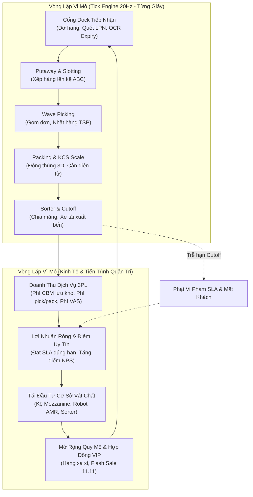
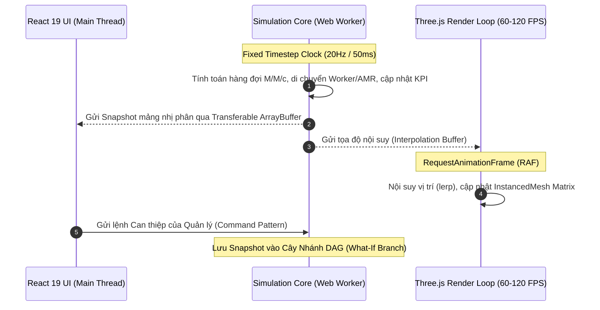

# 🏭 MASTER GAME PRODUCTION & SIMULATION PLAN
## DỰ ÁN: FULFILLMENT TYCOON: MISSION CONTROL 3D (BẢN KẾ HOẠCH TOÀN DIỆN CHUẨN STUDIO GAME QUỐC TẾ)

> **Nhà phát triển**: Antigravity Interactive & Boxme Simulation Studio  
> **Phiên bản tài liệu**: Production Plan 3.0 — Studio Master Bible  
> **Ngày phê duyệt**: 06/10/2026  
> **Thời gian sản xuất dự kiến**: 16 tuần (4 Cột mốc sản xuất chính)  
> **Nền tảng mục tiêu**: WebGL 2.0 / WebGPU (Desktop Chrome, Safari, Edge), Steam PC/Mac, Hệ thống Digital Twin Doanh nghiệp.

---

```
  ██████╗  ██████╗ ██╗  ██╗███╗   ███╗███████╗    ████████╗██╗   ██╗ ██████╗ ██████╗  ██████╗ ███╗   ██╗
  ██╔══██╗██╔═══██╗╚██╗██╔╝████╗ ████║██╔════╝    ╚══██╔══╝╚██╗ ██╔╝██╔════╝██╔═══██╗██╔═══██╗████╗  ██║
  ██████╔╝██║   ██║ ╚███╔╝ ██╔████╔██║█████╗         ██║    ╚████╔╝ ██║     ██║   ██║██║   ██║██╔██╗ ██║
  ██╔══██╗██║   ██║ ██╔██╗ ██║╚██╔╝██║██╔══╝         ██║     ╚██╔╝  ██║     ██║   ██║██║   ██║██║╚██╗██║
  ██████╔╝╚██████╔╝██╔╝ ██╗██║ ╚═╝ ██║███████╗       ██║      ██║   ╚██████╗╚██████╔╝╚██████╔╝██║ ╚████║
  ╚═════╝  ╚═════╝ ╚═╝  ╚═╝╚═╝     ╚═╝╚══════╝       ╚═╝      ╚═╝    ╚═════╝ ╚═════╝  ╚═════╝ ╚═╝  ╚═══╝
                      [ 3D CYBER-INDUSTRIAL LOGISTICS SIMULATOR & DIGITAL TWIN ]
```

---

## MỤC LỤC TÀI LIỆU
1. **EXECUTIVE SUMMARY & TẦM NHÌN SẢN PHẨM (Product Vision)**
2. **HỆ THỐNG CƠ CHẾ TRÒ CHƠI CỐT LÕI (Core Gameplay Mechanics & Loops)**
3. **CHI TIẾT 8 PHÂN HỆ NGHIỆP VỤ & MÔ HÌNH TOÁN HỌC (The 8 Simulation Engines)**
4. **CÁC CHẾ ĐỘ CHƠI (Game Modes & Career Progression)**
5. **KIẾN TRÚC KỸ THUẬT PHẦN MỀM (Technical Architecture & Engineering)**
6. **HƯỚNG DẪN NGHỆ THUẬT & ÂM THANH (Art & Audio Direction Bible)**
7. **LỘ TRÌNH SẢN XUẤT 16 TUẦN & PHÂN BỔ NGUỒN LỰC (Production Roadmap & Sprints)**
8. **CHIẾN LƯỢC THƯƠNG MẠI HÓA & KHAI THÁC KÉP (Go-To-Market & Dual-Track Value)**

---

## 1. EXECUTIVE SUMMARY & TẦM NHÌN SẢN PHẨM (Product Vision)

### 1.1 Khái Niệm Cốt Lõi (Elevator Pitch)
**Fulfillment Tycoon: Mission Control 3D** là trò chơi mô phỏng chiến thuật quản trị kho hàng e-commerce kết hợp nền tảng bản sao số (Digital Twin) thời gian thực. Người chơi đóng vai trò **Giám đốc Điều hành Trung tâm Hoàn tất Đơn hàng (Fulfillment Center Director)**, chỉ huy toàn bộ hoạt động từ việc dỡ từng container hàng tại cổng dock, phân tầng giá kệ thông minh (ABC Slotting), điều phối các đợt nhặt hàng theo Wave, đóng thùng 3D chống sốc, cân KCS điện tử tự động, đến vận hành vòng chia chọn Cross-Belt Sorter tốc độ cao để kịp giờ xuất bến xe tải (Carrier Cutoff).

### 1.2 Điểm Độc Đáo Khác Biệt (Unique Selling Propositions - USPs)
1. **Độ chân thực công nghiệp chuẩn xác (Industrial Rigor)**: Không đơn thuần là các con số trừu tượng, trò chơi mô phỏng đúng các định luật vật lý logistics: bài toán đường đi TSP trong lối đi hẹp, va chạm xe nâng, hao mòn thể lực công nhân khi đi bộ 15km/ngày, phí phạt neo xe (Demurrage) và thể tích quy đổi cước bay (Dimensional Weight).
2. **Kép đôi giá trị (Consumer Game + Enterprise Digital Twin)**: Vừa là game giải trí gây nghiện cho game thủ yêu thích thể loại Tycoon/Factorio, vừa là công cụ sa bàn diễn tập "What-If" và chạy mô phỏng ngẫu nhiên Monte Carlo 1.000 kịch bản cho các nhà quản lý chuỗi cung ứng chuyên nghiệp.
3. **Cây nhánh thời gian (Time-Travel DAG Branching)**: Cho phép người chơi tạm dừng, quay ngược thời gian về 30 phút trước khi xảy ra sự cố vỡ trận đơn hàng để thử nghiệm các quyết định can thiệp khác nhau và so sánh trực quan hiệu quả ROI.
4. **Hình ảnh & Âm thanh "Industrial ASMR"**: Đồ họa 3D Cyber-Industrial bóng bẩy trên nền WebGL/Three.js với hơn 10.000 kiện hàng hiển thị đồng thời mượt mà 60-120 FPS, kết hợp cùng dải âm thanh công nghiệp thư giãn, sống động.

---

## 2. HỆ THỐNG CƠ CHẾ TRÒ CHƠI CỐT LÕI (Core Gameplay Mechanics & Loops)

Hệ thống vận hành thông qua sự tương tác mật thiết giữa hai vòng lặp trò chơi:



### 2.1 Vòng Lặp Vi Mô (Micro Operational Loop)
Mỗi đơn hàng thương mại điện tử là một thực thể di chuyển xuyên suốt qua 5 công đoạn vật lý. Tắc nghẽn tại bất kỳ nút giao nào (ví dụ: bàn đóng gói hết băng dính, máng sorter bị đầy kiện, xe nâng hết pin giữa đường) sẽ tạo nên phản ứng dây chuyền làm nghẽn ngược toàn bộ hệ thống upstream.

### 2.2 Vòng Lặp Vĩ Mô (Macro Tycoon Loop)
Người chơi cân đối dòng tiền hàng ngày giữa Doanh thu phí dịch vụ 3PL với Chi phí vận hành (Mặt bằng, tiền điện máy móc, tiền lương thợ, tiền bảo dưỡng, phí bồi thường SLA). Dòng tiền thặng dư dùng để mở khóa các tầng công nghệ mới trong cây tiến trình (Tech Tree), mua thêm diện tích kho và đấu thầu các hợp đồng cung ứng béo bở.

---

## 3. CHI TIẾT 8 PHÂN HỆ NGHIỆP VỤ & MÔ HÌNH TOÁN HỌC (The 8 Simulation Engines)

Dựa trên kết quả nghiên cứu chuyên sâu, 8 phân hệ được xây dựng độc lập với các công thức toán học và cơ chế gameplay chặt chẽ:

### 📌 3.1 Phân Hệ Inbound & Thuật Toán Phân Tầng ABC Slotting
* **Nghiệp vụ**:
  - Quản lý lịch hẹn xe tải cập cổng dock (Dock Door Scheduling).
  - Thuật toán phạt neo xe (Demurrage Cost):
    $$\text{Cost}_{\text{demurrage}} = \max\left(0, (t_{\text{depart}} - t_{\text{appointment}} - T_{\text{grace}})\right) \times C_{\text{rate\_per\_min}}$$
  - Dỡ hàng: Palletized (xe nâng dỡ 45 phút/container) vs Loose Floor-loaded (thợ bốc tay 180 phút/container hoặc băng chuyền ống lồng 60 phút/container).
  - Kiểm soát chất lượng (QC): Quét mã LPN, OCR hạn sử dụng (RSL - Remaining Shelf Life), lồng cách ly hàng lỗi (Quarantine Cage).
  - Thuật toán phân bổ vị trí lưu kho ABC (ABC Velocity Slotting):
    $$V_{\text{SKU}} = \text{Tần suất nhặt (Picks/Day)} \times \text{Thể tích kiện (Cube)}$$
    - *Khu A (Fast-movers - Top 20% SKU)*: Kệ tầng thấp (Tầng 1-2) ngay đầu lối đi gần trạm đóng gói.
    - *Khu B (Medium-movers - 30% SKU)*: Dãy kệ trung tâm.
    - *Khu C (Slow-movers - 50% SKU)*: Kệ trên cao tầng 4-6 hoặc góc xa kho.
* **Cơ chế Game**:
  - Quyết định "Fast Dump" (nhét tạm hàng vào ô gần nhất để giải phóng dock đang nghẽn) sẽ khiến thời gian nhặt hàng của đơn sau đó tăng 300%.

---

### 📌 3.2 Phân Hệ Wave Batching & Giải Thuật Tối Ưu Đường Đi (In-Aisle TSP)
* **Nghiệp vụ**:
  - Gom đơn hàng theo Wave dựa trên giờ xe tải lấy hàng (Cutoff) và độ tương đồng vị trí kệ (Affinity Grouping).
  - Phương thức nhặt: *Single-order* (đơn cồng kềnh B2B), *Batch picking* (gom 50 đơn cùng lối đi vào xe đẩy nhiều ngăn), *Zone picking* (mỗi thợ quản một khu vực kệ).
  - Giải thuật tìm đường ngắn nhất trong lối đi (Traveling Salesperson Problem):
    - **S-Shape Heuristic**: Luồn lách hình chữ S qua từng dãy kệ, không quay đầu.
    - **Largest Gap Heuristic**: Chỉ đi vào lối đi đến điểm cần lấy sâu nhất rồi vòng ra nếu khoảng trống còn lại quá lớn.
* **Cơ chế Game**:
  - **Ùn tắc lối đi (Aisle Deadlock)**: Thiết kế lối đi quá hẹp ($1.8\text{m}$) khiến 2 xe nâng đối đầu nhau sẽ kích hoạt trạng thái nghẽn giao thông, buộc người chơi phải ban hành quy tắc lối đi 1 chiều (One-Way Aisle Policy).
  - Nâng cấp: Phiếu in giấy ($40$ UPH, lỗi $3.5\%$) $\rightarrow$ Máy quét PDA RF ($90$ UPH, lỗi $< 0.5\%$) $\rightarrow$ Xe đẩy Pick-to-Light ($160$ UPH) $\rightarrow$ Robot AMR Kiva chở kệ tới người ($350+$ UPH).

---

### 📌 3.3 Phân Hệ Đóng Gói, 3D Cartonization & Cân Điện Tử KCS
* **Nghiệp vụ**:
  - **Thuật toán Chọn Thùng 3D (3D Bin Packing)**: Tính toán kích thước ba chiều của giỏ hàng để chọn cỡ thùng 1-6 tối ưu, giảm thiểu cước phí thể tích:
    $$\text{DimWeight} = \frac{L \times W \times H}{5000}$$
  - **Gia công giá trị gia tăng (VAS)**: Bọc màng xốp nổ (Bubble Wrap) cho hàng dễ vỡ, dán tem quà tặng, đóng combo.
  - **Cân KCS Điện Tử Inline Chống Gian Lận / Thiếu Hàng**:
    $$\Delta W = |W_{\text{actual}} - (W_{\text{box}} + \sum W_{\text{SKU}} + W_{\text{dunnage}})|$$
    *Nếu $\Delta W > 15\text{g}$, xi-lanh tự động đẩy kiện hàng sang làn xả lỗi (Reject Spur) để kiểm tra lại.*
* **Cơ chế Game**:
  - **Quản lý vật tư tiêu hao**: Hết thùng số 3 hoặc hết băng dính sẽ khiến toàn bộ trạm đóng ngưng trệ.
  - Nâng cấp: Bàn đóng gỗ thủ công $\rightarrow$ Bàn đóng gắn con lăn trợ lực $\rightarrow$ Máy dán thùng tự động $\rightarrow$ Máy tạo thùng 3D Box-on-Demand (cắt giảm $40\%$ giấy carton).

---

### 📌 3.4 Phân Hệ Vòng Chia Chọn Sorter & Chạy Đua Giờ Cutoff ("Beat the Clock")
* **Nghiệp vụ**:
  - Vòng băng tải Cross-Belt Sorter tốc độ $2.5\text{ m/s}$, công suất $6.000$ bưu kiện/giờ kết hợp hầm quét mã vạch 6 hướng.
  - Phân bổ máng xả linh hoạt theo hãng vận chuyển (SPX, GHN, J&T, NinjaVan) và tuyến bưu cục tỉnh thành.
  - Tắc máng và Băng tải tuần hoàn (Recirculation Loop): Khi máng đầy, kiện hàng tiếp tục quay vòng. Tỷ lệ quay vòng $> 15\%$ sẽ tự động ngắt dòng cấp hàng upstream để chống sập ray.
  - Hạn chót xuất bến (Carrier Cutoff Deadlines): Chuyến 11:30 sáng, 17:00 chiều. Toàn bộ đơn hàng phải xếp lên xe tải trước giờ quy định.
* **Cơ chế Game**:
  - **Cơ chế đếm ngược gay cấn "Beat the Clock"**: 15 phút trước giờ Cutoff, còi báo động hú vang. Người chơi có thể kích hoạt lệnh "Overdrive Surge", điều động công nhân Inbound sang phụ tải xe. Nếu trễ 1 phút, xe bỏ đi, người chơi bị phạt đền $100\%$ cước phí và tụt điểm uy tín thương hiệu.

---

### 📌 3.5 Phân Hệ Mặt Bằng, Giá Kệ & Hạm Đội Robot AMR
* **Nghiệp vụ**:
  - Hệ thống giá kệ: Kệ Selective (lối đi $3.5\text{m}$), Kệ lối đi hẹp VNA ($1.8\text{m}$), Kệ sàn lửng Mezzanine kết hợp cẩu nâng hàng thẳng đứng (VRC).
  - Hạm đội Robot:
    - *AGV QR-Code*: Chạy theo vạch từ/mã QR dán trên sàn, giá rẻ, dễ dừng khi gặp chướng ngại vật.
    - *AMR LiDAR SLAM*: Tự động tránh người và xe nâng, cõng kệ $1.000\text{kg}$ tới trạm nhặt hàng.
    - *Trạm sạc nhanh cơ hội (Opportunity Charging)*: Robot tự động tìm về dock sạc pin khi dung lượng $< 20\%$.
* **Cơ chế Game**:
  - **Chế độ Xây dựng dạng Lưới (Grid Sandbox Builder)**: Tạm dừng thời gian để quy hoạch layout kho: kéo thả kệ, đặt cửa dock, bố trí trạm sạc, kẻ làn đường đi bộ / xe cơ giới.
  - Bài toán đánh đổi: Lối đi rộng (an toàn, xe chạy nhanh nhưng dung lượng kho thấp) vs Lối đi hẹp (tăng $45\%$ dung lượng nhưng dễ nghẽn xe và chi phí xe nâng VNA đắt gấp 3).

---

### 3.6 Phân Hệ Nhân Sự, Thể Lực & Cây Kỹ Năng RPG
* **Nghiệp vụ**:
  - Quản lý ca kíp 24/7: Ca Sáng ($06:00 - 14:00$), Ca Chiều ($14:00 - 22:00$), Ca Đêm ($22:00 - 06:00$, phụ cấp $+30\%$), Ca Tăng cường OT ($+50\% - 100\%$).
  - Hao mòn thể lực: Đi bộ $15\text{km}$/ngày khiến chỉ số Stamina tụt dốc. Thể lực $< 20\%$ làm tốc độ giảm một nửa và tỷ lệ nhặt sai tăng 5 lần.
* **Cơ chế Game**:
  - **Cây Kỹ Năng Nhân Viên (RPG Perks)**:
    - ⚡ *Speed Demon*: Tốc độ chạy bộ $+25\%$.
    - 🎯 *Eagle Eye*: Giảm $90\%$ nguy cơ quét nhầm mã SKU tương tự.
    - 🧩 *Tetris Master*: Tốc độ đóng thùng $+30\%$, tiết kiệm $15\%$ khoảng trống.
    - 🚜 *Forklift Ace*: Lái xe nâng tải nặng không rung lắc, không quẹt móp chân kệ.
    - 👑 *Inspiring Lead*: Tăng $10\%$ năng suất cho đồng đội trong bán kính $15\text{m}$.
  - Nâng cấp tiện nghi: Phòng nghỉ máy lạnh, máy pha cà phê miễn phí, ghế massage giúp công nhân hồi sức nhanh gấp đôi.

---

### 3.7 Phân Hệ Kinh Tế 3PL & Bộ Bài Biến Cố Khẩn Cấp (The Crisis Deck)
* **Nghiệp vụ**:
  - **Công thức Dòng tiền Ròng Hàng Ngày**:
    $$\Pi_{\text{daily}} = (R_{\text{storage}} + R_{\text{inbound}} + R_{\text{handling}} + R_{\text{pack\_materials}} + R_{\text{VAS}}) - (C_{\text{rent}} + C_{\text{labor}} + C_{\text{power}} + C_{\text{maintenance}} + C_{\text{penalties}})$$
* **Bộ Bài Biến Cố Khẩn Cấp (Crisis Deck)**:
  1. 💥 **Đại Tiệc Siêu Sale 11.11 / Black Friday**: Đơn hàng tăng vọt gấp 10 lần bình thường trong 6 giờ.
  2. ⚡ **Sập Lưới Điện Khu Công Nghiệp**: Mất điện toàn kho, máy phát diesel tự động kích hoạt với thời gian chạy tối đa 45 phút.
  3. 🌧️ **Mưa Bão Dột Mái Kho**: Nước tràn xuống ô kệ chứa lô hàng iPhone của đối tác VIP, người chơi phải điều xe nâng di dời khẩn cấp.
  4. 🌐 **Sập Mạng Máy Chủ WMS**: Máy quét PDA mất kết nối Wi-Fi, buộc phải kích hoạt quy trình nhặt hàng bằng giấy dự phòng.
  5. 🕵️ **Vụ Án Mất Trộm Hàng Hiệu**: Kiểm tra nhật ký camera ảo Virtual CCTV để tìm thủ phạm.

---

### 3.8 Phân Hệ Giao Diện 3D Digital Twin, Virtual CCTV & Âm Thanh ASMR
* **Nghiệp vụ**:
  - Telemetry SCADA giám sát thời gian thực, bản đồ nhiệt mật độ di chuyển, độ đầy của giá kệ và tần suất nhặt hàng Golden Zone.
* **Cơ chế Game**:
  - Giao diện Cyber-Industrial Dark Theme (`#0a1628` kết hợp Neon Blue `#00f2fe` và Alert Amber `#ff9f43`).
  - Màn hình camera an ninh ảo (Picture-in-Picture Virtual CCTV) cho phép theo dõi sát sao Cổng Dock, Lồng hàng quý và Line đóng gói.
  - Thiết kế âm thanh ASMR công nghiệp sống động: Tiếng quạt thông gió trầm ấm, tiếng con lăn băng tải rù rù, tiếng tít máy quét mã vạch, còi xe nâng.

---

## 4. CÁC CHẾ ĐỘ CHƠI & CÂY TIẾN TRÌNH CHIẾN DỊCH (Game Modes & Career Progression)

Hệ thống được thiết kế với 4 chế độ chơi phong phú:

```
┌────────────────────────────────────────────────────────────────────────────────────────┐
│                                 4 CHẾ ĐỘ CHƠI CỐT LÕI                                  │
├──────────────────────┬──────────────────────┬───────────────────┬──────────────────────┤
│  1. CHIẾN DỊCH       │  2. SANDBOX TỰ DO    │  3. THỬ THÁCH     │  4. DIGITAL TWIN     │
│  (Career Campaign)   │  (Grid-Based Builder)│  (Crisis Scenario)│  (Enterprise Sandbox)│
│  Mở rộng qua 5 Cấp độ│  Xây dựng kho mơ ước,│  Vượt qua 15 biến │  Nạp dữ liệu thật WMS│
│  từ 500m² -> 35.000m²│  tùy biến layout vô  │  cố khốc liệt nhất│  Mô phỏng Monte Carlo│
│  quản lý dòng tiền   │  hạn, thử tải robot  │  để đạt huy hiệu  │  What-If Decision DAG│
└──────────────────────┴──────────────────────┴───────────────────┴──────────────────────┘
```

### 4.1 Chi Tiết 5 Cấp Độ Chiến Dịch (The 5-Tier Campaign Progression)

| Cấp Độ (Tier) | Tên Phân Hạng | Diện Tích Sàn | Công Nghệ Chủ Đạo | Đơn Hàng / Ngày | Mục Tiêu Qua Màn |
|---|---|---|---|---|---|
| **Tier 1** | *The Starter Garage* | $500\text{ m}^2$ | Xe kéo tay thủ công, phiếu in giấy, bàn đóng gói gỗ. | $300 - 500$ đơn | Giữ dòng tiền dương 7 ngày liên tục, hoàn tất đơn đúng hạn 95%. |
| **Tier 2** | *Regional Depot* | $2.500\text{ m}^2$ | Kệ Selective 3 tầng, xe nâng điện, máy quét PDA cầm tay. | $3.000 - 5.000$ đơn | Đạt chuẩn ABC Slotting, mở ca 2, vượt qua tuần lễ khuyến mãi đầu tiên. |
| **Tier 3** | *High-Velocity E-Com Hub* | $8.000\text{ m}^2$ | Sàn lửng Mezzanine 2 tầng, xe nâng Reach Truck, máy dán thùng tự động, cân KCS. | $15.000 - 25.000$ đơn | Triển khai Wave Batching, giải quyết tắc đường trong lối đi hẹp, vượt qua Siêu Sale 9.9. |
| **Tier 4** | *Automated Hybrid Center* | $18.000\text{ m}^2$ | Vòng phân loại Cross-Belt Sorter, đội robot AMR cõng kệ, trạm đóng gói chuyên dụng. | $50.000 - 80.000$ đơn | Tối ưu hóa điều phối máng xả hàng, quản lý sạc pin robot, chạy đua với giờ Cutoff 2H. |
| **Tier 5** | *Lights-Out Mega Hub* | $35.000\text{ m}^2$ | Hệ thống ASRS khối hộp tự động 100%, xe đầu kéo sân bãi tự hành, AI điều phối luồng hàng. | $150.000+$ đơn | Vận hành toàn bộ trung tâm với năng suất tối đa, vượt qua đợt Siêu Bão Sale 11.11 với 0 đơn trễ hạn. |

---

## 5. KIẾN TRÚC KỸ THUẬT PHẦN MỀM (Technical Architecture & Engineering)

### 5.1 Kiến Trúc Đa Luồng Không Gây Nghẽn (Headless Web Worker & RAF Decoupling)



### 5.2 Bộ Thư Viện Kỹ Thuật (Tech Stack Selection)
* **Frontend Framework**: React 19 (React Server Components, Actions, Concurrent Mode).
* **3D Graphics Engine**: Three.js r170+ (PBR Metalness/Roughness, GLSL Shaders, InstancedMesh).
* **Hiệu Năng Dựng Hình**: `BufferGeometryUtils.mergeGeometries()`, `THREE.InstancedMesh` (1 Draw Call cho 10.000 kiện hàng và 500 nhân sự).
* **Hậu Kỳ Hình Ảnh**: N8AO (Screen Space Ambient Occlusion thế hệ mới), Selective UnrealBloomPass, ACESFilmicToneMapping.
* **Quản Lý Trạng Thái**: Zustand 5.0 (Tốc độ cập nhật cực nhanh ngoài React render cycle).
* **Engine Âm Thanh**: Web Audio API (Tổng hợp âm thanh thủ tục procedural + không gian 3D AudioListener).
* **Đa Ngôn Ngữ**: i18next (Hỗ trợ 4 thứ tiếng VI / EN / TH / ZH).

---

## 6. HƯỚNG DẪN NGHỆ THUẬT & ÂM THANH (Art & Audio Direction Bible)

### 6.1 Bảng Màu Nhận Diện Cyber-Industrial (Color Palette)
* **Màu Nền Chủ Đạo (Background)**: `#0a1628` (Xanh đêm công nghiệp thâm trầm).
* **Màu Tương Tác Chính (Primary Interactive)**: `#2454DD` (Xanh Boxme Electric Blue) và `#00f2fe` (Neon Cyan dẫn lối cho AMR).
* **Màu Cảnh Báo Nguy Cơ (Warning / Alert)**: `#ff9f43` (Hổ phách cảnh báo nguy cơ sập SLA) và `#ee5253` (Đỏ còi khẩn cấp).
* **Màu Sàn Nhà Xưởng (Epoxy Concrete)**: `#1e293b` với vân bánh xe mờ và vạch kẻ phân làn an toàn màu vàng `#feca57`.

### 6.2 Phong Cách Dựng Hình (Visual Style)
* Phong cách **Stylized Cyber-Industrial**: Tối giản các đa giác thừa (Low-Poly sạch sẽ) nhưng áp vật liệu PBR cao cấp (độ bóng sàn epoxy, kim loại phản quang xà thép, ánh đèn led nhấp nháy trên lưng robot).
* **Camera góc nhìn chiến thuật 45 độ** mang lại cảm giác bao quát như đang ngồi trước bàn điều khiển trung tâm tại NASA.

### 6.3 Cảnh Quan Âm Thanh "Industrial ASMR" (Soundscape Design)
* **Âm thanh nền (Ambient Layer)**: Tiếng rù rù êm dịu của quạt thông gió trần kho (tần số thấp $60\text{Hz}$).
* **Âm thanh dây chuyền (Mechanical Layer)**: Tiếng con lăn băng chuyền kim loại quay đều, tiếng "cộc cạch" của các lưỡi gạt máng sorter.
* **Âm thanh phản hồi hành động (Audio Feedback)**:
  - *Quét mã vạch thành công*: Tiếng "tít" trong trẻo vui tai (`Chime 880Hz`).
  - *Kiểm đếm sai SKU*: Tiếng "tè tè" trầm báo lỗi (`Buzz 220Hz`).
  - *Xe nâng lùi*: Tiếng bíp bíp nhịp nhàng phát theo vị trí không gian 3D.
  - *Hạn chót Cutoff*: Tiếng còi báo động khẩn cấp và tiếng đếm ngược dồn dập.

---

## 7. LỘ TRÌNH SẢN XUẤT 16 TUẦN & PHÂN BỔ NGUỒN LỰC (Production Roadmap & Sprints)

Kế hoạch sản xuất được chia làm 4 giai đoạn rõ ràng:

```
┌────────────────────────────────────────────────────────────────────────────────────────┐
│                                 TIẾN TRÌNH SẢN XUẤT 16 TUẦN                            │
├─────────────────────┬─────────────────────┬────────────────────┬───────────────────────┤
│  M0: NỀN MÓNG & PROT│  M1: VERTICAL SLICE │  M2: TOÀN BỘ 8 PHÂN│  M3: ĐÁNH BÓNG & PHÁT │
│  (Tuần 1 - 4)       │  (Tuần 5 - 8)       │  (Tuần 9 - 12)     │  (Tuần 13 - 16)       │
│  - Tách mã nguồn    │  - Pipeline hoàn chỉnh│ - Cây tiến trình 5│ - Đa ngôn ngữ 4 thứ   │
│  - Web Worker Core  │  - N8AO + Bloom 3D  │ - Crisis Deck 15 sự│ - Thử nghiệm Monte Ca │
│  - Mulberry32 PRNG  │  - Command Pattern  │ - Tycoon Economy 3P│ - Tối ưu 60-120 FPS   │
│  - InstancedMesh box│  - Âm thanh ASMR web│ - Grid Builder mode│ - Triển khai Pages/Ste│
└─────────────────────┴─────────────────────┴────────────────────┴───────────────────────┘
```

### 7.1 Phân Kỳ Chi Tiết Từng Sprint (Two-Week Sprints)
* **Sprint 1-2 (Tuần 1-4) - Nền Tảng Khung Mô Phỏng**:
  - Tách rời mã nguồn cũ `boxme-mission-control.html` thành cấu trúc modular TypeScript.
  - Xây dựng Simulation Core trên Web Worker với chu kỳ cố định 20Hz.
  - Tích hợp máy sinh số ngẫu nhiên tất định Mulberry32.
  - Dựng hệ thống `InstancedMesh` hiển thị 10.000 kiện hàng và 500 công nhân.
* **Sprint 3-4 (Tuần 5-8) - Bản Trình Diễn Đứng (Vertical Slice)**:
  - Hoàn thiện chu trình đầy đủ của 1 đơn hàng (Inbound $\rightarrow$ Slotting $\rightarrow$ Wave Pick $\rightarrow$ Pack $\rightarrow$ Sorter).
  - Tích hợp hậu kỳ N8AO, Selective Bloom và bộ điều khiển camera mượt mà GSAP.
  - Triển khai Command Pattern hỗ trợ Undo/Redo và lưu Snapshot cây nhánh DAG.
  - Lập trình bộ tổng hợp âm thanh Web Audio API (tiếng máy quét, tiếng xe nâng).
* **Sprint 5-6 (Tuần 9-12) - Toàn Bộ 8 Phân Hệ & Kinh Tế Tycoon**:
  - Hoàn thiện trọn bộ 8 phân hệ nghiệp vụ theo tài liệu OpenSpec.
  - Xây dựng hệ thống kinh tế 3PL (thu phí lưu kho, phí pick/pack, chi phí điện, mặt bằng).
  - Lập trình Bộ bài 15 biến cố khẩn cấp (Siêu Sale 11.11, Sập điện, Mưa dột, Sập WMS).
  - Mở khóa chế độ Xây dựng dạng lưới (Grid-based Sandbox Builder).
* **Sprint 7-8 (Tuần 13-16) - Đánh Bóng, Quốc Tế Hóa & Phát Hành**:
  - Dịch thuật và kiểm thử giao diện 4 thứ tiếng: Tiếng Việt, Tiếng Anh, Tiếng Thái, Tiếng Trung.
  - Tối ưu hóa hiệu năng đảm bảo chạy mượt mà 60-120 FPS trên laptop thông thường.
  - Đóng gói bản cài đặt Desktop (Tauri/Electron) và triển khai bản Web lên Cloudflare Pages / Steam.

---

## 8. CHIẾN LƯỢC THƯƠNG MẠI HÓA & KHAI THÁC KÉP (Go-To-Market & Dual-Track Value)

Dự án sở hữu mô hình kinh doanh độc đáo nhờ khả năng phục vụ đồng thời hai thị trường mục tiêu:

```
                                  HỆ SINH THÁI KHAI THÁC KÉP
                                              │
                    ┌─────────────────────────┴─────────────────────────┐
                    ▼                                                   ▼
       [ KÊNH CONSUMER GAMING ]                             [ KÊNH ENTERPRISE B2B SAAS ]
  - Nền tảng: Steam PC / Web Game                      - Nền tảng: Boxme Mission Control 2.5
  - Đối tượng: Game thủ đam mê Tycoon / Sim            - Đối tượng: Ban Giám Đốc, Quản Lý Kho, Khách Hàng VIP
  - Mô hình: Bán game trả phí ($19.99) hoặc Freemium   - Mô hình: Đào tạo nhân sự, Diễn tập Siêu Sale, Digital Twin
  - Nội dung: 5 Cấp độ chiến dịch, Mở khóa robot,      - Nội dung: Nạp dữ liệu thật WMS, Chạy thử nghiệm What-If,
    Thử thách đối đầu Siêu Bão Sale 11.11                Dự báo rủi ro sập SLA Monte Carlo 1.000 kịch bản.
```

### 8.1 Giá Trị Đối Với Doanh Nghiệp (Enterprise Value)
* **Giảm thiểu rủi ro vận hành mùa Sale**: Cho phép các giám đốc kho bãi chạy trước kịch bản Siêu Sale ngày hôm sau, xác định chính xác số lượng công nhân cần thuê thêm và giờ xuất bến xe tải tối ưu trước khi thực tế diễn ra.
* **Công cụ đào tạo nhân sự trực quan nhất**: Nhân viên mới và trưởng ca có thể thực hành điều phối kho ngay trên mô hình 3D mà không sợ gây thiệt hại hàng hóa thật ngoài đời.
* **Công cụ bán hàng & chốt hợp đồng B2B đỉnh cao**: Trình chiếu mô hình 3D Digital Twin sống động cho các nhãn hàng quốc tế để chứng minh năng lực tự động hóa và công nghệ quản trị vượt trội của trung tâm hoàn tất đơn hàng.

### 8.2 Giá Trị Đối Với Thị Trường Game (Consumer Gaming Value)
* Khai phá một thị trường ngách đầy tiềm năng: Game quản lý logistics thực tế (Logistics Tycoon) đang có nhu cầu rất lớn trên Steam nhưng thiếu các tựa game có đồ họa 3D hiện đại và chiều sâu nghiệp vụ chuẩn mực.
* Tính năng Time-Travel DAG và bộ bài biến cố ngẫu nhiên mang lại giá trị chơi lại (replayability) gần như vô tận.

---

## LỜI KẾT
Bản Kế Hoạch Sản Xuất Game Toàn Diện này đánh dấu bước chuyển mình quan trọng từ một ý tưởng thử nghiệm thành một dự án game quản trị kho bãi 3D đẳng cấp quốc tế. Với nền tảng nghiên cứu nghiệp vụ vững chắc, kiến trúc phần mềm tách lớp hiện đại và lộ trình sản xuất chi tiết, dự án đã sẵn sàng bước vào giai đoạn hiện thực hóa mã nguồn!

---
© 2026 Boxme Simulation Studio & Antigravity Interactive. Tất cả các quyền được bảo hộ.
